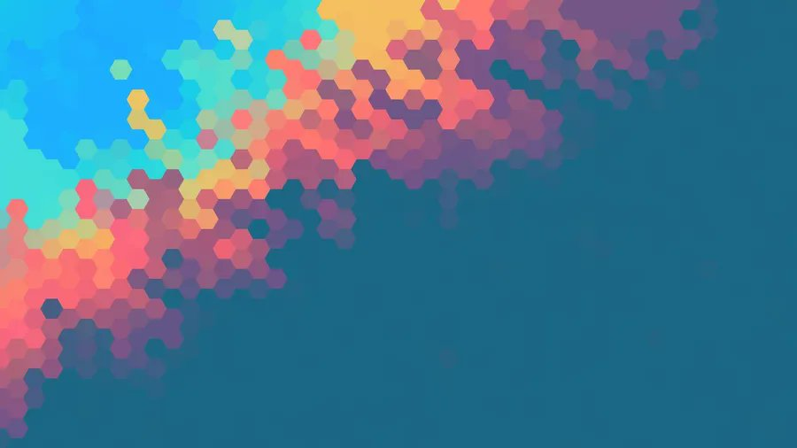
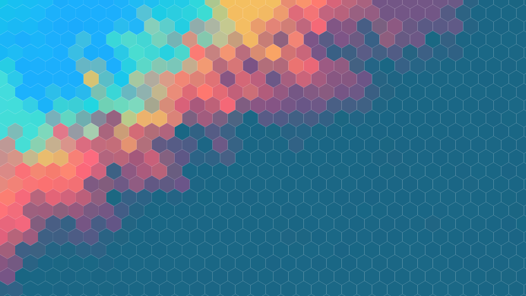
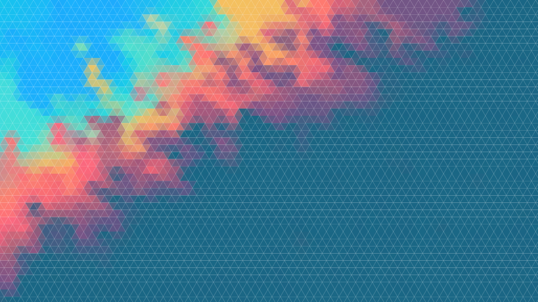

# Small Python Project
In this project, we need to build a Python project which can be transform form one PNG Picture (low resolution) to one SVG Picture (high resolution). We need to cover all knowledge which is introduced by teacher in **Refresher in Computer Science Course**:
- Setup professional project structure.
- Use necessary git skills: automated workflow (CI/CD), git tag, git branch, git push, git add, issues,.....
- Marimo notebook.
- Publish the interactive notebook to Github Page via WASM
- Unit Test.
- Publish Package PyPI.
- Build CLI command.
- Use uv to control python virtual enviroment.

## Structure Root of the Project
```
last-project
    |                        
    |                         |---- tests.yml (automatic test)
    |______ .github/workflows/|---- publish.yml (automatically publish PyPI Package)
    |                         |---- deploy-pages.yml (aumatically GitHub Page)
    |
    |______ images/ (contain the PNG Images)
    |
    |
    |______ notebooks/ ---- hexagon_explorer.py (Marimo Notebook)
    |
    |
    |                   |---- __init__.py
    |______ src/png2svg/|---- core.py (main function to convert PNG to SVG)
    |                   |---- cli.py (build command-line interface to convert PNG to SVG)
    |
    |             |---- test_cli.py   (define some unit tests for CLI)
    |______ tests/|---- test_core.py  (define unit test for main functions)
    |
    |______ .gitignore
    |
    |______ pyproject.toml (setting of project)
    |
    |______ requirement.txt
```
## Result of this project on the Initial Version
- The publish package using PyPI, everyone can search the package on the Internet by the link: [link package](https://pypi.org/project/png2svg-viethung103/),
and using **pip install png2svg-viethung103** to install the package.

- The publish webpage for hexagon explorer, you can upload the image of PNG Format and choose the hexagon size that you want, the result of Hexagon
format will be present in the bottom of the webpage. You can also download this image to your laptop. The link of webpage: [webpage link](https://viethung103.github.io/Last_Project_Computer_Science/)

<p align="center">
    
<p>

**Input Image**
<p align="center">
    
<p>

**Output Image of First Version**
<p align="center">
    
<p>

## Result of this project on the Bonus Version
In this part, we update some feature for this project that we can import diversity image file such as .png, .jpeg,... choose any size of hexagon. Moreover, we add the triangle
transform also not only hexagon and can generate Hexagon paper with palette colors. Finally, the code of the project is refractored in OOP instead of procedural code. You can see the result above to see the different result compare
to the first's one

**Output Image of Bonus Version**
<p align="center">
    
<p>

## Command Line Interface
After installing the package (`pip install png2svg-viethung103`), the `png2svg` command is available. Inside this repository, put `uv run` in front of it (for example `uv run png2svg images/screenshot.png`).

### Convert a picture
`images/screenshot.png` is the path in my project so change it to match with your version.
| Command | Explanation |
|---|---|
| `png2svg images/screenshot.png` | Convert the picture to hexagons (size 10, size default) and write `output.svg`. |
| `png2svg images/screenshot.png -o output.svg` | -o for output, saving the result to `output.svg`. |
| `png2svg images/screenshot.png -s 5` | -s for set the expect size for hexagon. |
| `png2svg images/screenshot.png --shape triangle -s 15 -o triangles.svg` | --shape for choosing the shape(hexagon or triangle). |
| `png2svg photo.jpg -s 12 -o photo.svg` | Any picture format and size works (JPG, PNG, ...). |

### Generate a wallpaper from a color palette (no picture needed)

| Command | Explanation |
|---|---|
| `png2svg --palette "#264653,#2a9d8f,#e9c46a" -o wallpaper.svg` | Hexagon wallpaper 800×600 with random colors from the palette, saved to `wallpaper.svg`. |
| `png2svg --palette "#264653,#2a9d8f,#e9c46a" --distribution gradient` | Colors go from left to right in bands instead of random. |
| `png2svg --palette "#264653,#2a9d8f,#e9c46a" --shape triangle` | Triangle wallpaper with random colors. |
| `png2svg --palette "#264653,#2a9d8f,#e9c46a" --width 1920 --height 1080` | Full-HD size wallpaper. |
| `png2svg --palette "#264653,#2a9d8f,#e9c46a,#f4a261,#e76f51" --distribution gradient --shape triangle --width 1920 --height 1080 -s 40 -o wallpaper.svg` | All options together: full-HD gradient wallpaper of 40 px triangles. |

### Help and error cases

| Command | Explanation |
|---|---|
| `png2svg -h` | Show the help message with all options. |
| `png2svg` | Error: `Give an input image or --palette.` |
| `png2svg missing.png` | Error: `Input file not found: missing.png` |
| `png2svg images/screenshot.png -s 0` | Error: `Size must be positive number.` |

### Development commands

| Command | Explanation |
|---|---|
| `uv sync --all-groups` | Install the project and all development tools. |
| `uv run pytest` | Run all unit tests with the coverage report. |
| `uv run ruff check .` | Check the code style. |
| `uv run ruff format .` | Format the code automatically. |
| `uv run mypy src` | Check the types. |
| `uv run marimo edit notebooks/hexagon_explorer.py` | Open the notebook in the browser to edit and run it. |
| `uv run marimo run notebooks/hexagon_explorer.py` | Open the notebook as an app (read-only). |
| `uv run marimo export html-wasm notebooks/hexagon_explorer.py -o site --mode run` | Build the web (WASM) version of the notebook into `site/`. |
| `uv build` | Build the package files into `dist/`. |
| `uv run python -c "from png2svg import convert; convert('images/screenshot.png', 'output.svg', 10)"` | Use the library from Python instead of the CLI. |
