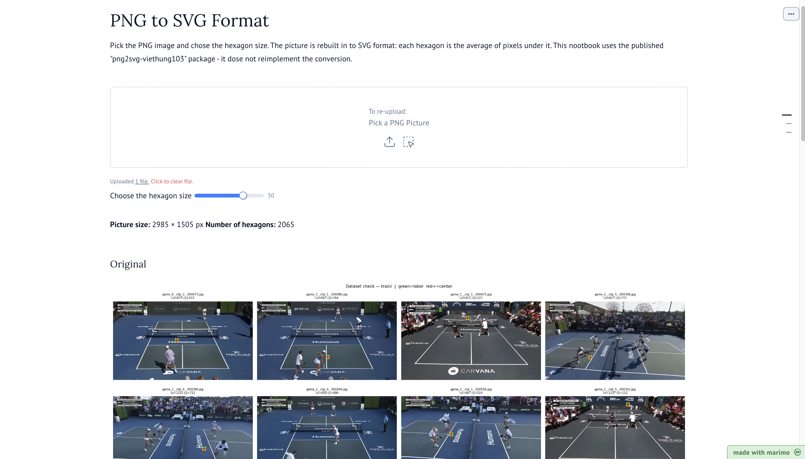

# Small Python Project
In this project, we need to build a Python project which can be transform form one PNG Picture (low resolution) to one SVG Picture (high resolution). We need to cover all knowledge which is introduced by teacher in **Refresher in Computer Science Course**:
- Setup professional project structure.
- Use necessary git skills: automated workflow (CI/CD), git tag, git branch, git push, git add, issues,.....
- Marimo notebook.
- Publish the interactive notebook to Github Page via WASM
- Unit Test.
- Publish Package PyPI.
- Build CLI command.
- Use uv to control python virtual enviroment.

## Structure Root of the Project
```
last-project
    |                        
    |                         |---- tests.yml (automatic test)
    |______ .github/workflows/|---- publish.yml (automatically publish PyPI Package)
    |                         |---- deploy-pages.yml (aumatically GitHub Page)
    |
    |______ images/ (contain the PNG Images)
    |
    |
    |______ notebooks/ ---- hexagon_explorer.py (Marimo Notebook)
    |
    |
    |                   |---- __init__.py
    |______ src/png2svg/|---- core.py (main function to convert PNG to SVG)
    |                   |---- cli.py (build command-line interface to convert PNG to SVG)
    |
    |             |---- test_cli.py   (define some unit tests for CLI)
    |______ tests/|---- test_core.py  (define unit test for main functions)
    |
    |______ .gitignore
    |
    |______ pyproject.toml (setting of project)
    |
    |______ requirement.txt
```
## Result of this project
- The publish package using PyPI, everyone can search the package on the Internet by the link: [text](https://pypi.org/project/png2svg-viethung103/),
and using **pip install png2svg-viethung103** to install the package.

- The publish webpage for hexagon explorer, you can upload the image of PNG Format and choose the hexagon size that you want, the result of Hexagon
format will be present in the bottom of the webpage. You can also download this image to your laptop. The link of webpage: [text](https://viethung103.github.io/Last_Project_Computer_Science/)

<p align="center">
    
<p>